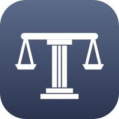
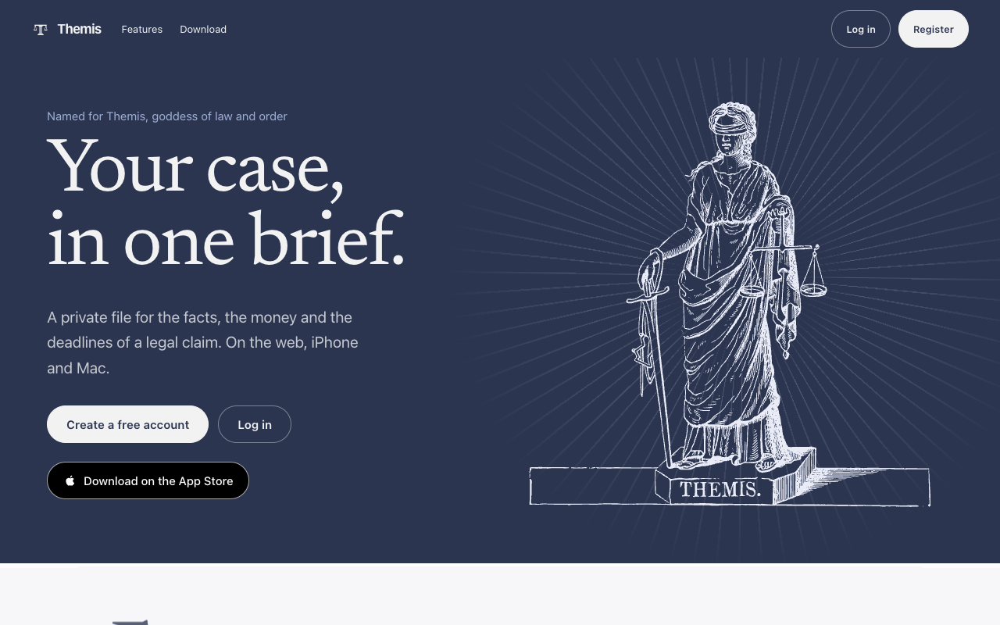
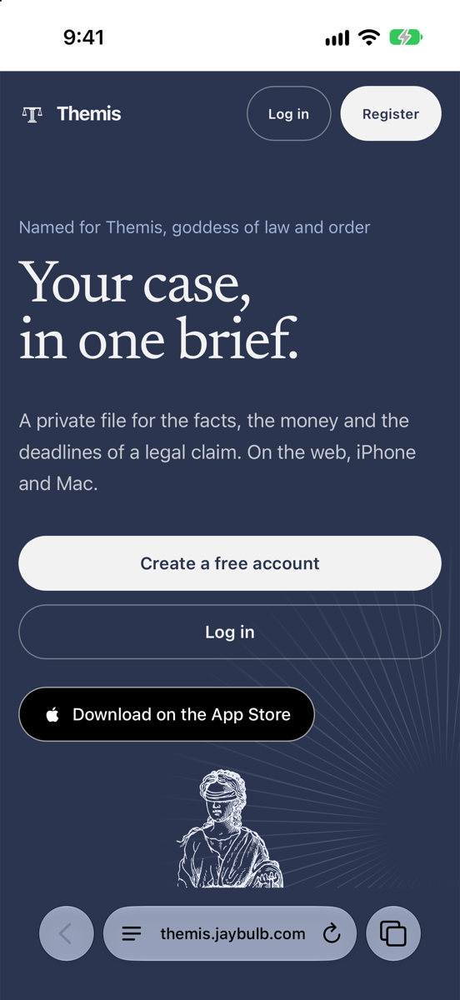
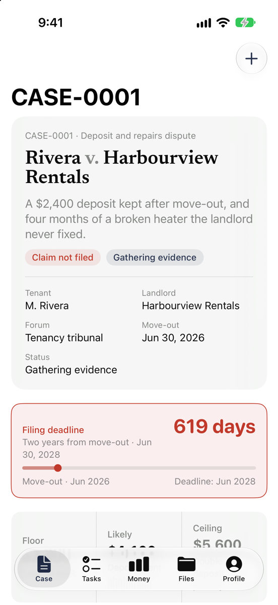
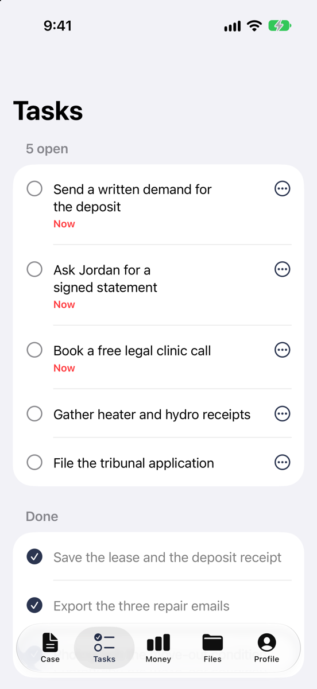
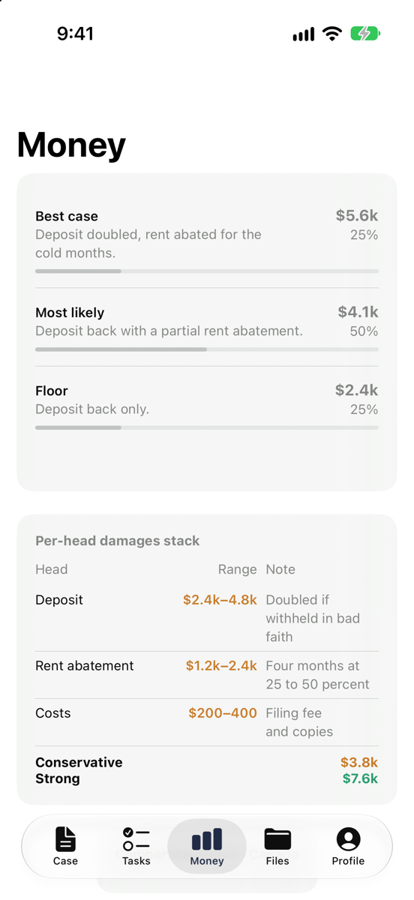
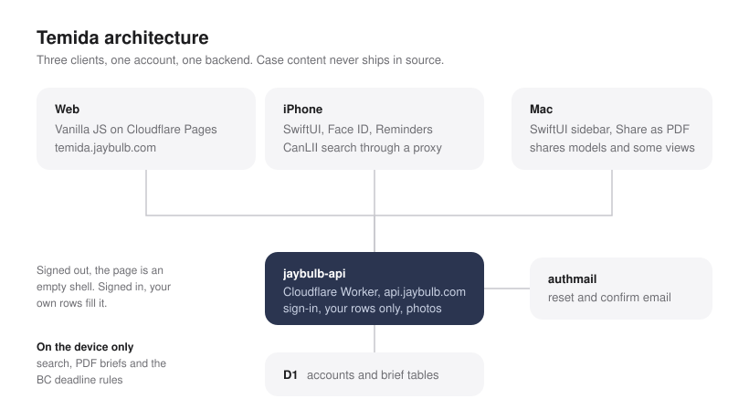

  

Going to court without a lawyer is a lot of paper. Temida keeps it in one place. Formerly Themis, Atticus and Litigate.

Sign in and keep your own cases: facts, grounds, witnesses, damages scenarios, lawyers,
timeline and next steps. Add facts, grounds, witnesses, deadlines and lawyers yourself, search everything, and print a PDF for counsel. Each
account sees only its own briefs. In six languages: English, French, Spanish, Chinese
(simplified and traditional) and Punjabi.

**Web:** [temida.jaybulb.com](https://temida.jaybulb.com) · [Brand kit](https://temida.jaybulb.com/brand/) · [App Store](https://apps.apple.com/app/id6787857503)

 

  

Screenshots use a made-up demo case.

---


## Platforms

| Platform | Dir | Stack |
|---|---|---|
| Web | `web/` | Vanilla JS PWA on Cloudflare Pages |
| iOS | `ios/` | SwiftUI, iOS 17+ |
| macOS | `macos/` | SwiftUI, macOS 14+, shares models and some views with iOS |

All three sign in and sync through jaybulb-api (api.jaybulb.com, Cloudflare Workers and D1).

## Features

- Case: cover sheet, limitation clock, facts, witnesses, grounds, journal
- Add to case: facts, grounds, witnesses, deadlines and lawyers on every platform, with Edit and Remove
- Deadlines: pick a BC rule (2-year basic, 15-year ultimate, 2-month notice to a city) and the due date and cite fill in
- Search: one box for the case, the journal and the documents, on the device only
- PDF: Print on the web, Share as PDF in the apps
- Tasks: open steps first, sent to Reminders or Calendar in one tap
- Money: scenarios, damage heads, comparable awards
- Files: documents, and CanLII case-law search (iPhone only)
- Profile: name and photo (upload or generate), reset password, sign out, delete account
- Sign-in: email on the web; email, Apple and Google in the apps. Face ID lock on iPhone only

## Roadmap

See [roadmap.md](roadmap.md). Next up: editing and removing what you added, then grounds and
witnesses.

## Build

```bash
# Web
cd web && python3 -m http.server 8080

# iOS
cd ios && xcodegen generate && open Temida.xcodeproj

# macOS
cd macos && xcodegen generate && open Temida.xcodeproj
```

## License

Apache License 2.0. Copyright 2026 Joshua Trommel.

## Whitepaper

[Technical whitepaper](WHITEPAPER.md)

## API and agent tools

An agent can drive this app. [`docs/API.md`](docs/API.md) lists the HTTP surface, where there
is one, and the WebMCP tools registered on `document.modelContext`. Tools come in three kinds:
read-only, writes you can undo, and the few that ask a human first.

## Architecture


